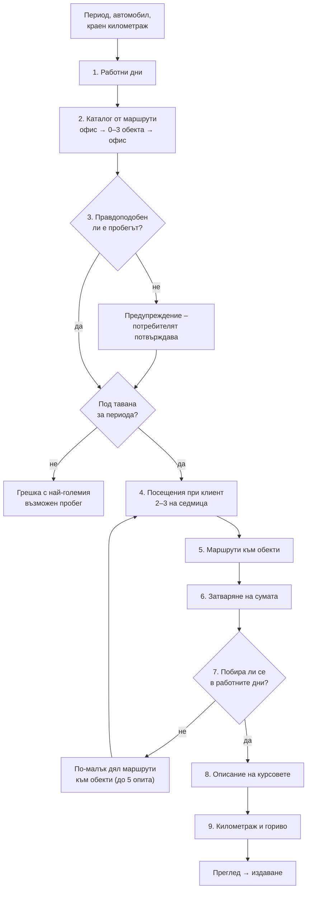

<div align="center">

# Пътни Листи Завинаги

**Уеб приложение за пътни листове: по въведен краен километраж разпределя изминатите километри в маршрути по работни дни, смята нормативния разход на гориво и издава номериран лист в PDF и Excel.**

Разработено за **BLD** · Версия 1.2 · Октомври 2026 · [Промени](CHANGELOG.md)

[**▶ Отвори приложението**](https://veseliakaes-arch.github.io/patni-listi-zavinagi/) · [Изходен код](https://github.com/veseliakaes-arch/patni-listi-zavinagi) · [Примерен лист (PDF)](primeren-paten-list.pdf)

</div>

---

## Съдържание

1. [Какво прави](#1-какво-прави)
2. [Възможности](#2-възможности)
3. [Използвани технологии](#3-използвани-технологии)
4. [Стартиране локално](#4-стартиране-локално)
5. [Как се работи](#5-как-се-работи)
6. [Алгоритъм за маршрутите](#6-алгоритъм-за-маршрутите)
7. [Реквизити на пътния лист](#7-реквизити-на-пътния-лист)
8. [Валидации и контрол](#8-валидации-и-контрол)
9. [Съхранение на данните](#9-съхранение-на-данните)
10. [Разстояния (OSRM)](#10-разстояния-osrm)
11. [Сигурност](#11-сигурност)
12. [Тестове](#12-тестове)
13. [Файлове в хранилището](#13-файлове-в-хранилището)
14. [Ограничения и развитие](#14-ограничения-и-развитие)

---

## 1. Какво прави

Потребителят избира автомобил и водач, проверява предложения период и въвежда **километража в края на периода**. Приложението:

- разпределя изминатите служебни километри в маршрути само в **работни дни** – до обектите на BLD, до административни сгради и посещения при клиент;
- гарантира, че **сумата на маршрутите е равна на въведения пробег** (отклонение най-много ±1 км) и че километражът е непрекъснат от ред на ред и от лист на лист;
- смята **нормативния разход** на гориво (литри или kWh) по нормата на автомобила;
- издава лист с **пореден номер** `ПЛ-ГГГГ-NNNN`, готов за печат (PDF, A4) и за обработка (Excel).

Всичко работи в браузъра – без сървър, без регистрация и без инсталиране.

## 2. Възможности

| Област | Какво прави приложението |
|---|---|
| **Маршрути** | Само в работни дни: без събота и неделя, официалните празници, Великден и пренесените почивни дни. Еднократни почивни дни се въвеждат ръчно. Без повтарящ се шаблон. |
| **Точност** | Сумата на маршрутите е равна на въведения пробег (±1 км); километражът е непрекъснат между редовете. |
| **Посещения при клиент** | 2–3 на работна седмица, всяко до 50 км общо (25 км в посока); поемат разликата между картографските и въведените километри. |
| **Гориво** | Бензин, дизел, електрически (kWh), газ (пропан-бутан), метан; разход = км × норма / 100. |
| **Контрол на километража** | Верига между листовете на един автомобил, без застъпване на периодите; позволена е задна дата. |
| **Проверка на пробега** | Предупреждение при необичайно голям пробег и потвърждение, преди да се генерира; дневен лимит 300 км и след ръчни промени. |
| **Редакция** | Всеки ред може да се промени, да се смени маршрутът (↻) или да се изтрие; сумите се преизчисляват веднага. |
| **Експорт** | PDF (A4, с места за подпис) и Excel (.xlsx) – за един лист или за всички филтрирани. |
| **История** | Последователна номерация, филтри по автомобил и период, повторен експорт. |
| **Зареждания** | Дата, количество и номер на фактура. |
| **Данни** | Резервно копие на всички данни (.json) и възстановяване от него; ясно съобщение, ако браузърът не може да запише данните. |

## 3. Използвани технологии

| Част | Технология | Бележка |
|---|---|---|
| Интерфейс | **HTML5, CSS3, JavaScript (ES2020)** | Без framework и без сборка. Тъмна и светла тема чрез CSS променливи. |
| PDF | **[pdfmake](https://pdfmake.github.io/docs/) 0.2.7** | Шрифт Roboto с пълна кирилица. |
| Excel | **[SheetJS](https://sheetjs.com/) 0.18.5** | Само запис на .xlsx (виж [Сигурност](#11-сигурност)). |
| Шрифт на сайта | **Manrope** | SIL OFL 1.1. |
| Съхранение | **`localStorage`** на браузъра | Данните остават на компютъра на потребителя. |
| Разстояния | **[OSRM](https://project-osrm.org/)** върху **[OpenStreetMap](https://www.openstreetmap.org/copyright)** | Пътни разстояния между обектите; © участниците в OpenStreetMap, лиценз ODbL. |
| Хостинг | **GitHub Pages** | Статичен сайт. |
| Тестове | **Node.js 18+**, вграденият `node:test` | Без външни пакети. |

Библиотеките и шрифтът са **в самото хранилище** – сайтът не зарежда нищо от външни CDN или Google Fonts. Единствената външна заявка е към OSRM. Версии, източници, контролни суми и лицензи: [BIBLIOTEKI.md](BIBLIOTEKI.md).

## 4. Стартиране локално

**Нужно е:** съвременен браузър (Chrome, Edge, Firefox или Safari). За тестовете – [Node.js](https://nodejs.org/) 18 или по-нов. Интернет трябва само за изчисляването на разстоянията от OSRM; без него приложението ползва ориентировъчните разстояния.

```bash
git clone https://github.com/veseliakaes-arch/patni-listi-zavinagi.git
cd patni-listi-zavinagi
```

След това има два начина:

1. **Без сървър:** отворете `index.html` в браузъра (двоен клик). Работи изцяло, но браузърът не позволява да се прочете `distances.json` от диска, затова разстоянията идват от OSRM.
2. **С локален сървър** (по-близо до истинския сайт):

   ```bash
   python3 -m http.server 8000     # или: npx serve .
   ```

   и отворете <http://localhost:8000>.

**Тестове:**

```bash
node --test
```

**Публикуване:** в GitHub → *Settings → Pages → Deploy from a branch → `main` / root*. Всички файлове са в корена на хранилището, затова се качват и през сайта на GitHub с *Add file → Upload files*. При нова версия сменете номера `?v=` в `index.html`, за да не смесва браузърът новите файлове със стари от кеша.

## 5. Как се работи

1. **Автомобили, водачи, дестинации (еднократно)** – автомобили (марка, модел, рег. номер, гориво, норма на 100 км, начален километраж), водачи, други офиси и собствени дестинации. Данните на фирмата са записани в `data.js` и в приложението са само за четене.
2. **Нов пътен лист** – изберете автомобил и водач; периодът се предлага сам (след последния лист на колата); въведете **КМ края на периода**. В „Още опции“ са офис, лични километри, почивни дни, зареждания и одобрил.
3. **Генерирай маршрути** – ако пробегът е необичайно голям, приложението първо пита дали километражът е верен.
4. **Преглед** – таблица с маршрутите, сума, разлика спрямо въведения пробег и разход. Всеки ред се редактира; ↻ сменя маршрута, ✕ маха реда.
5. **Издай и свали PDF / Excel** – листът получава следващия номер и файлът се сваля веднага.
6. **История** – всички издадени листове, филтри и повторен експорт.
7. **Данни и резервно копие** – в „Автомобили, водачи, дестинации“: сваляне и възстановяване на всички данни.

## 6. Алгоритъм за маршрутите

**Цел:** сумата на километрите по маршрутите да е равна на въведения служебен пробег *T = краен км − начален км − лични км*, а маршрутите да изглеждат реалистично и да не се повтарят като шаблон. Кодът е в `algorithm.js` – чисти функции без зависимост от страницата.



### 6.1. Работни дни

От периода остават понеделник–петък без:

- официалните празници с фиксирана дата (чл. 154, ал. 1 от Кодекса на труда);
- **Великден** – от Велики петък до Великденския понеделник; датата се изчислява за всяка година (православна пасхалия);
- почивните дни, **пренесени** по чл. 154, ал. 2 КТ, когато празник се падне в събота или неделя – първият работен ден след него (например 25.05.2026 и 07.09.2026);
- еднократните почивни дни от полето „Почивни дни“ – `02.01.2026` или интервал `24.12.2026..28.12.2026`. Невалидна дата спира генерирането с ясно съобщение.

### 6.2. Разстояния и каталог от маршрути

Каталогът съдържа всички вериги **начална точка → 0 до 3 дестинации → крайна точка** с дължина до 295 км (дневният лимит минус 5). Разстоянието между две точки се взима, по ред на предимство:

1. от матрицата с пътни разстояния (OSRM или `distances.json`, виж [раздел 10](#10-разстояния-osrm));
2. от таблицата „км в една посока от офиса“ в настройките, ако едната точка е офисът;
3. от оценка между две дестинации без данни: `max(3, round(0,6 · min(a, b) + 0,5 · |a − b|))`, където *a* и *b* са разстоянията им до офиса.

С обектите по подразбиране и ориентировъчните разстояния вариантите са 696, с дължина от 10 до 49 км.

### 6.3. Проверки преди генериране

- **Правдоподобност.** Ако средният пробег е **над 120 км на работен ден**, или е **над 1,5 пъти средното от последните до 3 листа** на автомобила (и с поне 20 км на ден повече), приложението показва причината и генерира едва след потвърждение. Целта е да хване печатна грешка в километража. За септември 2026 (20 работни дни) предупреждението е над 2400 км.
- **Таван.** На ден има най-много 3 курса към обекти, а всеки е най-много колкото най-дългия маршрут от каталога (но поне 50 км). Таванът е *работни дни × min(295, 3 × max(най-дългия маршрут, 50))*. С ориентировъчните разстояния това е 150 км на работен ден – 3000 км за септември 2026. Над тавана излиза грешка с най-големия възможен пробег.

### 6.4. Посещения при клиент

Всяка работна седмица (понеделник–петък) получава посещения при клиент: при поне 2 работни дни – `max(1, round(дни / 5 × [2 или 3]))`, при 1 ден – 0 или 1 със случаен избор. Всяко започва със случайни 12–44 км. Ако посещенията заедно надхвърлят половината от *T*, се махат случайни посещения, докато станат до половината.

### 6.5. Маршрути към обекти

За останалите километри се избират случайни маршрути от каталога, докато остатъкът е поне най-краткият маршрут + 6 км. Всеки маршрут:

- е най-много колкото остатъкът минус 6 км (оставя място за затварянето);
- не прави сумата на маршрутите към обекти по-голяма от техния капацитет за периода (виж 6.7);
- не е същият като предишния избран (няма „шаблон“);
- се избира с тегло, равно на броя на обектите в него – маршрутите с повече спирки са по-чести, както е при истински обиколки.

Изборът използва предварително сортиран каталог и двоично търсене, затова остава бърз и при много дестинации (150 дестинации – около секунда).

### 6.6. Затваряне на сумата

Километрите на маршрутите към обекти **остават равни на картографските**. Остатъкът до *T* се добавя към посещенията при клиент (всяко до 50 км), в случаен ред. Ако и това не стигне, се добавят нови посещения при клиент: *n = ⌈остатък / 50⌉*, с поравно разделени километри. Остатък от 1 км не може да стане отделно посещение (минимумът е 2 км) и остава като разлика от 1 км – затова толерансът е ±1 км.

### 6.7. Разпределение по дни и повторен опит

Маршрутите се разбъркват и се слагат на случайни работни дни – първо по един на ден, после на дни с място. Ограниченията за един ден са: **до 300 км** и **до 3 курса**; посещение при клиент може да бъде 4-ти или 5-ти курс за деня. Посещенията при клиент остават в деня, за който са планирани, ако има място.

Капацитетът за маршрути към обекти е *работни дни × min(295, 3 × средната дължина на маршрут от каталога)*. Ако някой курс не се побира в дните, всичко от 6.4 нататък се повтаря, като маршрутите към обекти могат да заемат 100 %, 90 %, 80 %, 70 % и накрая 60 % от капацитета – останалото поемат посещенията при клиент. Ако и петият опит не успее, излиза грешка.

### 6.8. Описание на курсовете

Всеки курс получава начална и крайна точка (офисът по подразбиране или избран друг офис), маршрут `начало → обекти → край` и цел. Целта е случайна от списък според вида на обекта: за строителен обект („Оглед на обект“, „Контрол на СМР“ и др.), за административна сграда („Подаване на документи“ и др.) или за клиент. Собствените дестинации използват целта, въведена за тях.

### 6.9. Километраж и гориво

Началният километраж на всеки ред е крайният на предишния, а първият ред започва от крайния километраж на предишния лист на колата. Разходът на всеки ред е *км × норма / 100*, закръглен до 0,01 л (kWh за електрически автомобили), а общият разход е сборът на редовете.

### 6.10. Смяна на маршрут (↻)

Бутонът ↻ сменя маршрута на един ред, като **новият маршрут е със своите картографски километри**:

1. първо се търсят маршрути със същите км – в тестовете има такъв в 99,8 % от случаите;
2. ако няма, се взима маршрут с близки км (разлика до 8 км или до 15 % – което е повече), а разликата се поема от посещенията при клиент – първо от същия ден. Така сумата на листа остава същата, посещенията остават между 2 и 50 км и нито един ден не минава 300 км. Приложението казва кое посещение е променено.

Посещенията при клиент не се сменят с ↻ – те се редактират на ръка.

**Резултат:** разликата между сумата и въведения пробег е 0 км в над 99 % от случаите и най-много 1 км. Генерирането е случайно, но може да се повтори: `generate()` приема генератор на случайни числа и тестовете подават генератор със семе.

## 7. Реквизити на пътния лист

Документът (PDF и Excel) съдържа:

- пореден номер, дата на издаване и период;
- фирма: наименование, ЕИК, адрес, МОЛ;
- автомобил: марка, модел, регистрационен номер, вид гориво, норма на разход;
- водач и длъжност;
- за всеки курс: дата, начална точка, маршрут, крайна точка, цел;
- начален и краен километраж за всеки ред и за периода, изминати километри;
- разход на гориво по редове и общо; лично ползване;
- зареждания: дата, количество, номер на фактура;
- места за подпис на **водача** и на **одобрилия** (ръководител/МОЛ).

## 8. Валидации и контрол

**Преди генериране**

- Крайният километраж е по-голям от началния; личните километри не надвишават общите.
- Началният километраж е равен на крайния от предишния лист на колата, а при задна дата крайният е равен на началния на следващия.
- Периодите на един автомобил не се застъпват.
- Задължителен водач; датата на зареждане е в периода; почивните дни са валидни дати.
- Необичайно голям пробег изисква потвърждение (6.3).

**При преглед и издаване** – листът **не се издава**, ако:

- разликата е над ±1 км;
- има курс с дата извън периода;
- някой ден е над 300 км (например след ръчна промяна) – денят се показва в „Преглед“;
- браузърът не може да запише данните (виж раздел 9).

**История**

- Номерацията е последователна. Изтриват се само **последните 3** листа, с потвърждение; при изтриване на лист, който не е последен, се показва предупреждение за пропуск в номерацията.
- Основните адреси (обектите на BLD и административните сгради) са заключени и не се изтриват.

## 9. Съхранение на данните

Всички данни се пазят в `localStorage` на браузъра (ключ `pl_v2`) – само на този компютър и в този браузър.

- **Неуспешен запис** (пълно хранилище, частен режим, блокирани данни): най-горе се показва причината и листът **не се издава**, за да не се повтори номерът му.
- **Нечетими данни**: нищо не се презаписва. Приложението минава в режим „само четене“ и предлага „Свали данните“, „Започни на чисто“ (старите данни остават като копие) или възстановяване от резервно копие.
- **Резервно копие**: „Автомобили, водачи, дестинации“ → „Данни и резервно копие“ – сваляне на всичко като .json и възстановяване. Копието се проверява поле по поле, преди да замени данните.
- По желание браузърът може да бъде помолен да не изчиства данните при липса на място.

## 10. Разстояния (OSRM)

1. В `data.js` са координатите на офиса, обектите на BLD и административните сгради.
2. При първо отваряне браузърът прави **една** заявка към публичния OSRM (`router.project-osrm.org`, таблица с пътни разстояния между всички точки) и запазва резултата.
3. Резултат, по-къс от 0,9 × правата линия или по-дълъг от 2,2 × правата линия + 1,5 км, се заменя с оценка: права линия × 1,3.
4. Ако OSRM е недостъпен, се ползват ориентировъчните километри от настройките и сайтът продължава да работи.
5. Ако до `index.html` има `distances.json`, той има предимство пред OSRM. Създава се с `izchisli-razstoyaniya.html` (координатите се поставят от Google Maps, OSRM смята разстоянията) или с `node build-distances.mjs` (точките без координати се търсят през Nominatim на OpenStreetMap).

Най-долу на страницата е посочен източникът: OSRM и © участниците в OpenStreetMap (ODbL).

## 11. Сигурност

- Няма сървър, база данни и пароли – данните не излизат от браузъра на потребителя.
- Всички стойности се екранират, преди да влязат в страницата, а резервното копие се проверява поле по поле. Подправен файл не може да вкара в страницата HTML или код – това е покрито от тестовете.
- Всички скриптове са от самия сайт; единствената външна заявка е към OSRM и от нея се ползват само числа.
- SheetJS 0.18.5 има известни уязвимости при **четене** на файлове (CVE-2023-30533, CVE-2024-22363). Приложението само **записва** Excel, затова не са достъпни. Преди да се добави импорт от Excel, библиотеката трябва да се обнови (виж [BIBLIOTEKI.md](BIBLIOTEKI.md)).

## 12. Тестове

```bash
node --test
```

33 теста, около секунда, без инсталиране на пакети. Всички случайни генерирания са със семе, затова всяка грешка се повтаря; друго семе: `SEED=12345 node --test`.

- **`algorithm.test.mjs`** – работни дни; Великден 2024–2030; неработните дни за 2026 г.; пренасяне на празници; полето „Почивни дни“; толеранс ±1 км при 500 пробега; точно съвпадение в над 98 % от случаите; дневен лимит; посещения при клиент (до 50 км, 2–3 седмично); липса на повтарящ се шаблон; начална и крайна точка; ясна грешка при непосилен пробег; километраж и разход; повторимост; ↻ (сумата се запазва, км на новия маршрут са картографските, дневният лимит се спазва); дни над лимита; проверка за правдоподобен пробег.
- **`storage.test.mjs`** – запис и зареждане: отказан запис, пълно хранилище, браузър без запис, нечетими данни, данни от стара версия, „Започни на чисто“, резервно копие и отхвърляне на подправено копие.

В приложението има и **самотест** (Автомобили, водачи, дестинации → Диагностика) – 300 случайни генерирания.

## 13. Файлове в хранилището

Всички файлове са в корена, без папки.

| Файл | Какво е |
|---|---|
| `index.html` | Страницата: разметка и реда на скриптовете |
| `app.css` | Стиловете |
| `algorithm.js` | Алгоритъмът: работни дни и празници, маршрути, проверки, сметки (без DOM) |
| `storage.js` | Запис и зареждане в браузъра без тихи грешки |
| `data.js` | Данни на фирмата, обекти, координати, миграция и проверка на данните |
| `export.js` | PDF и Excel |
| `app.js` | Интерфейсът – екрани и действия |
| `pdfmake.min.js`, `vfs_fonts.js`, `xlsx.full.min.js`, `manrope-*.woff2` | Библиотеките и шрифтът ([BIBLIOTEKI.md](BIBLIOTEKI.md)) |
| `LICENSE-pdfmake.txt`, `LICENSE-sheetjs.txt`, `LICENSE-manrope.txt` | Лицензите им |
| `algorithm.test.mjs`, `storage.test.mjs` | Тестовете |
| `izchisli-razstoyaniya.html`, `build-distances.mjs`, `points.json` | Изчисляване на реални разстояния |
| `primeren-paten-list.pdf`, `primeren-paten-list.xlsx` | Примерен лист |
| `header.jpg` | Снимката в заглавието |
| `distances.json` | По избор: готова матрица с разстояния (има предимство пред OSRM) |

Скриптовете се зареждат в този ред: библиотеките, `algorithm.js`, `storage.js`, `data.js`, `export.js`, `app.js`. Първите три създават обектите `Algo`, `Store` и `AppData` и се зареждат и в Node (`require`), затова тестовете ги ползват директно.

## 14. Ограничения и развитие

**Ограничения на тази версия**

- Данните се пазят само в браузъра – без вход и без споделяне между потребители. Сваляйте редовно резервно копие.
- Приложението трябва да е отворено в **един** раздел: два отворени раздела могат да запишат един върху друг.
- При изтриване на последния лист номерът му се освобождава и следващият лист го получава.
- Общият разход е сбор от закръглените стойности по редове и може да се различава с няколко стотни от *км × норма / 100* за целия период.
- Разстоянията са ориентировъчни, докато не се зареди матрица от OSRM или `distances.json`.
- Еднократните почивни дни, обявени от Министерския съвет, не се знаят предварително – въвеждат се в „Почивни дни“.
- Няма карта на маршрутите.

**Планирано развитие**

| Приоритет | Функция |
|---|---|
| 1 | База данни и вход с потребител и парола (Supabase – PostgreSQL), хостинг на Cloudflare Pages |
| 2 | Автоматично зареждане на реални разстояния от OSRM през собствен бекенд |
| 3 | Карта на маршрутите (Leaflet / OpenStreetMap) и автоматично довършване на адреси |
| 4 | Табло с обобщения по автомобили, водачи и периоди |
